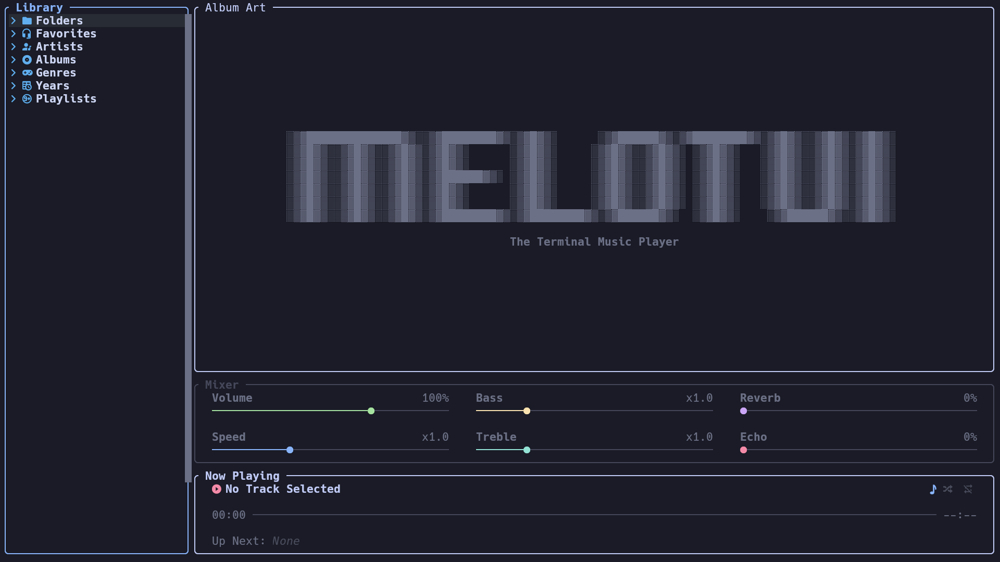
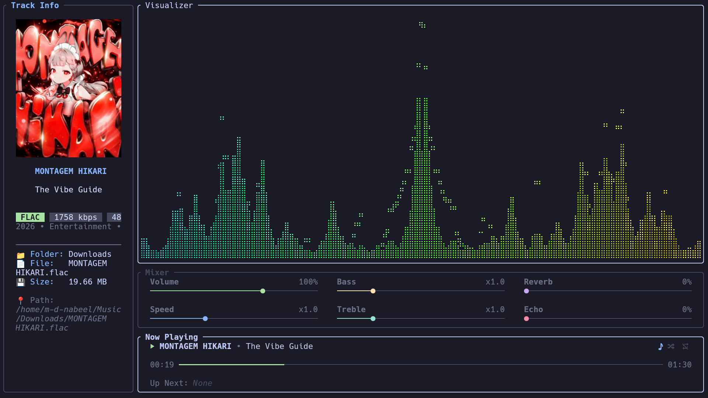
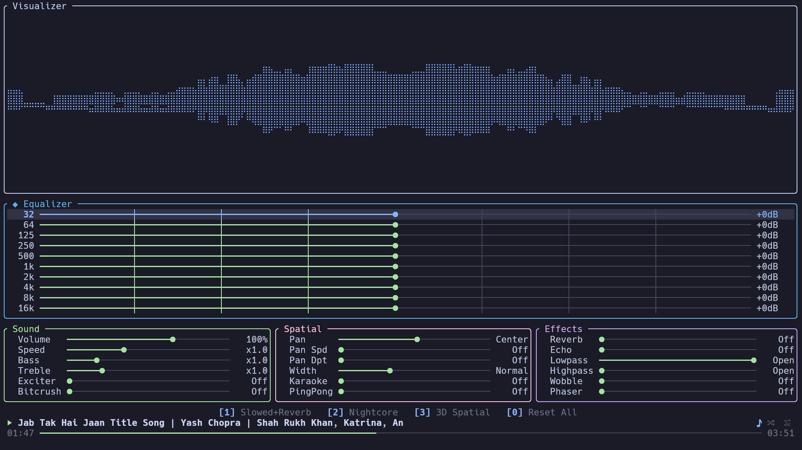

# melotui

`melotui` is a fast, responsive, and feature-rich terminal-based music player written in Rust. It features real-time audio visualization, DSP effects (like Nightcore and Slowed+Reverb), integrated YouTube downloading, and system media controls.





## Core Features

- **Local Library & Playlists**: Your music folders are scanned at start and watched while running, so new music appears by itself.
- **Audio Playback**: Support for MP3, FLAC, M4A, WAV, OGG, and OPUS.
- **Spectrum Visualizer**: Six styles, cycled with `Shift+V` or picked with `:vis <style>`: Particle (the default, a fountain of droplets thrown up by the music), Default and Bar (mirrored bars with falling caps), Radial (a turning ring), Nova (particles sprayed out of a pulsing core, with a burst on every kick), and Cava when [CAVA](https://github.com/karlstav/cava) is installed. It follows the music, not the volume slider, and rests when playback is paused.
- **Synced Lyrics**: Time-synced lyrics from `.lrc` files, the lyrics in your files' own tags, or fetched from LRCLIB as a song starts. Hindi, Urdu and other complex or right-to-left scripts are drawn properly on terminals with image support (kitty, Ghostty, WezTerm, iTerm2, and Sixel terminals such as Windows Terminal, foot and Konsole).
- **DSP Studio**: Real-time audio processing (speed, bass, treble, reverb, echo, panning, width, filters and more) with a 10-band EQ and presets.
- **System Integration**: Shows in the desktop's media controls on Linux, macOS and Windows, and answers media keys and headset buttons.
- **Download Support**: Integrated YouTube downloads via `yt-dlp`, tagged with the song's title and artist rather than the video's title and channel.

---

## Installation

> [!IMPORTANT]
> **Dependencies are required!**
> Since `melotui` interfaces directly with your system's audio devices and DBUS for media controls, you **must** install the native development libraries before building.

### 1. Install System Dependencies

**Ubuntu / Debian:**

```bash
sudo apt-get update
sudo apt-get install -y libasound2-dev libdbus-1-dev pkg-config
```

**Fedora / RHEL:**

```bash
sudo dnf install alsa-lib-devel dbus-devel pkgconf-pkg-config
```

**macOS:**
*(macOS handles audio and media controls natively via CoreAudio/CoreMedia, so no additional system libraries are required for compilation!)*

### 2. Install yt-dlp (Optional but Recommended)

To use the in-app YouTube download feature (`:dl <query>`), you must have `yt-dlp` installed and available in your system's PATH.

- [yt-dlp installation guide](https://github.com/yt-dlp/yt-dlp/wiki/Installation)

### 3. Install

**Prebuilt binary** — download the archive for your platform from the [latest release](https://github.com/m-d-nabeel/melotui/releases/latest) (Linux x86_64, macOS Intel and Apple Silicon, Windows x86_64), or let [cargo-binstall](https://github.com/cargo-bins/cargo-binstall) fetch it:

```bash
cargo binstall --git https://github.com/m-d-nabeel/melotui melotui
```

**From source** — with [Rust installed](https://rustup.rs/):

```bash
cargo install --git https://github.com/m-d-nabeel/melotui melotui
```

or clone the repository and build it:

```bash
git clone https://github.com/m-d-nabeel/melotui.git
cd melotui
cargo build --release
```

The compiled binary will be at `./target/release/melotui`.

---

## Usage

Start the player:

```bash
melotui
```

Options: `--config <FILE>` reads another config file, `--no-config` starts with the built-in settings and reads no config file, theme or keymaps, `--no-restore` starts without the last session, `--paths` prints where melotui keeps its config, library, presets, logs and caches, and `--help` and `--version` do what they say.

> [!TIP]
> **Need help?**
> Once inside the app, press `?` for every key and command; `j`/`k` scroll it, and `q` or `Esc` closes it.

### Keys

The keys follow what cmus, ncmpcpp and mpv agree on.

| Keys | What they do |
| --- | --- |
| `Space` | Play or pause |
| `<` `>` (or `Ctrl+←` `Ctrl+→`) | Previous and next track |
| `←` `→`, `,` `.` | Seek 5 seconds, and a minute |
| `+` `-`, `m` | Volume, and mute |
| `[` `]`, `Backspace` | Slower and faster, and normal speed |
| `s`, `r`, `Shift+S` | Shuffle, repeat mode, and stop |
| `j` `k` (or `↑` `↓`), `g` `G` (or `Home` `End`), `PgUp` `PgDn` | Move in the tree or queue |
| `Enter`, `Tab` | Play or open, and switch between the tree and the queue |
| `a`, `A`, `f`, `p` | Add to the queue, play next, favorite, add to a playlist |
| `i`, `l` | Track info, and lyrics |
| `v`, `Shift+V` | Album art or visualizer, and the next visualizer style |
| `F1`, `F2` | Layout, and the DSP studio, where the effects are adjusted |
| `:`, `?`, `q` | Commands, help, and quit |

Volume, speed and effects changed out of sight of the mixer are shown in a notification. Press `:` for the command bar (e.g., `:dl lofi hip hop` or `:quit`): it lists every command as you type, and `Tab` and `Shift+Tab` complete commands, their options, and playlist and preset names. Keys can be changed in `keymaps.toml` (`melotui --paths` shows where).

### Commands

| Command | What it does |
| --- | --- |
| `:play`, `:pause`, `:stop`, `:next`, `:prev` | Playback |
| `:seek +10`, `:seek 1:30` | Seek by or to a position |
| `:vol 80`, `:vol +10`, `:speed 1.25` | Volume (in percent) and speed |
| `:shuffle on`, `:repeat track` | Shuffle and repeat |
| `:fx bass 2`, `:fx eq 3 -4`, `:fx reset` | Effects, the EQ, and resetting them |
| `:fx slowed`, `:preset load <name>` | Effect macros and presets |
| `:lyrics fetch`, `:lyrics search <query>` | Fetch or look up lyrics |
| `:lyrics zoom 3`, `:lyrics zoom panel 2` | Lyrics size |
| `:focus lyrics`, `:vis nova`, `:toggle art` | Layout, visualizer and panels |
| `:device`, `:device <name>`, `:device default` | Audio output device |
| `:pl add <playlist>`, `:artist <query>` | Playlists and search |

### Audio output

melotui plays through the system's default output unless told otherwise, and keeps playing when a device goes away: unplug the headphones or lose the Bluetooth connection and the track carries on through the default output from where it was. Pick a device with `:device <name>` (Tab completes the names), or for good in `config.toml`:

```toml
[audio]
output_device = "USB Audio"   # the name, or part of it
```

A chosen device that is not there is stood in for by the default until it comes back.

### Lyrics

A song's lyrics come from a `.lrc` file in melotui's `lyrics` folder (`melotui --paths` shows where), named `Artist - Title.lrc` or after the audio file, from a `.lrc` beside the song, or from the song's own tags. A song with none has them fetched from [LRCLIB](https://lrclib.net) as it starts, into that folder, never into the music folders; the lyrics panel opens when a song has lyrics, unless you have closed it. Fetching sends the song's title, artist, album and length to lrclib.net; turn it off in `config.toml`:

```toml
[lyrics]
auto_fetch = false
```

### Lyrics size

On terminals that can show images (kitty, Ghostty, WezTerm, iTerm2, and Sixel terminals such as Windows Terminal, foot and Konsole), lyrics are drawn larger than the terminal's text: twice the size in the lyrics panel and three times in the full lyrics view (`:focus lyrics`) by default. Change them for the session with `:lyrics zoom <1-4>`, or for good in `config.toml` (`~/.config/melotui/config.toml` on Linux):

```toml
[ui]
lyrics_zoom = 2.0        # lyrics panel
lyrics_zoom_focus = 3.0  # full lyrics view
```

## License

Licensed under either of

- Apache License, Version 2.0 ([LICENSE-APACHE](LICENSE-APACHE) or <https://www.apache.org/licenses/LICENSE-2.0>)
- MIT license ([LICENSE-MIT](LICENSE-MIT) or <https://opensource.org/licenses/MIT>)

at your option.

### Contribution

Unless you explicitly state otherwise, any contribution intentionally submitted for inclusion in the work by you, as defined in the Apache-2.0 license, shall be dual licensed as above, without any additional terms or conditions.
