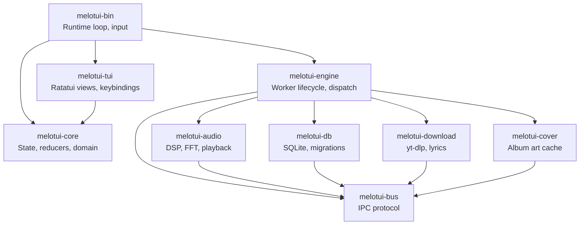

# Melotui — Deep Project Analysis & Future Focus Plan

## Current State Assessment

### What You've Built

Melotui is a **remarkably well-architected** terminal music player. The 9-crate workspace is clean, with genuine separation of concerns:



### Strengths

| Area | Details |
|------|---------|
| **Architecture** | Elm-like unidirectional data flow: `Input → AppMsg → Reducer → State → View`. The [bridge.rs](file:///home/m-d-nabeel/Project/melotui/crates/melotui-engine/src/bridge.rs) layer is a clean, testable translation layer between domain messages and IPC. |
| **Testing** | Solid coverage across [effects.rs](file:///home/m-d-nabeel/Project/melotui/crates/melotui-audio/src/effects.rs#L68-L110), [config.rs](file:///home/m-d-nabeel/Project/melotui/crates/melotui-core/src/config.rs#L292-L399), [command.rs](file:///home/m-d-nabeel/Project/melotui/crates/melotui-core/src/command.rs#L336-L501), [bridge.rs](file:///home/m-d-nabeel/Project/melotui/crates/melotui-engine/src/bridge.rs#L217-L311), [keybinding.rs](file:///home/m-d-nabeel/Project/melotui/crates/melotui-tui/src/keybinding.rs#L576-L689), [view.rs](file:///home/m-d-nabeel/Project/melotui/crates/melotui-tui/src/view.rs#L204-L275). |
| **CI** | Multi-platform (Linux, Windows, macOS) with test, lint (fmt+clippy), and release build jobs. |
| **Config system** | TOML-based with validation, tilde expansion, external themes, external keymaps. Well-structured with clamping. |
| **DSP pipeline** | FunDSP graph with real-time parameter updates via `Shared`, block-based processing (64 samples), stereo reverb with dry/wet mixing and a limiter. |
| **Command mode** | Proper shell-like parser with quoted strings, autocomplete, history, and a rich command set. |

---

## Unmerged Work on `feat/synced-lyrics`

You have **~4,275 lines added** on `feat/synced-lyrics` vs `master`. This branch contains far more than lyrics:

| Feature | Status |
|---------|--------|
| Synced lyrics display + search (LRCLIB, OVH) | ✅ Implemented |
| Toggleable playback panel | ✅ Implemented |
| LyricsPlayback focus mode | ✅ Implemented |
| Configurable keybindings (external TOML) | ✅ Implemented |
| Key parser for complex sequences | ✅ Implemented |
| Command autocomplete + history | ✅ Implemented |
| Multi-directory music library | ✅ Implemented |
| Config expansion (UI, audio, FPS, FFT, etc.) | ✅ Implemented |
| Dynamic theme loading | ✅ Implemented |
| Notification priorities | ✅ Implemented |

> [!IMPORTANT]
> **This branch needs to be merged.** It's 16 commits ahead of master with substantial, stable features. The longer it sits, the harder the merge becomes.

---

## Technical Debt & Issues Found

### 1. Hardcoded sample rate in FFT

In [fft.rs:52](file:///home/m-d-nabeel/Project/melotui/crates/melotui-audio/src/fft.rs#L52), the sample rate is hardcoded to `44100`:

```rust
let spectrum_result = samples_fft_to_spectrum(
    &hann_window,
    44100,  // ← hardcoded, should come from source
    ...
);
```

FLAC files at 96kHz or 48kHz will produce incorrect frequency mapping.

### 2. DSP graph is recreated on every play

In [worker.rs:143](file:///home/m-d-nabeel/Project/melotui/crates/melotui-audio/src/worker.rs#L143), a new `AudioUnit` is created for each track. The `Shared` params survive across tracks, but the graph itself is rebuilt — this means all DSP state (reverb tails, echo buffers) is lost on track transitions.

### 3. Unhandled `DatabaseCommand` variants

The [DatabaseCommand](file:///home/m-d-nabeel/Project/melotui/crates/melotui-bus/src/command.rs#L49-L65) enum has `GetAllTracks`, `SearchTracks`, `GetPlaylists`, `IncrementPlayCount`, `Query` — but these are caught by the `_ => {}` wildcard in [db/worker.rs:186](file:///home/m-d-nabeel/Project/melotui/crates/melotui-db/src/worker.rs#L186). FTS search is wired in the schema but not queryable from the app.

### 4. `FundspSource` output channel count mismatch

In [source.rs:129](file:///home/m-d-nabeel/Project/melotui/crates/melotui-audio/src/source.rs#L129), `channels()` returns `self.source.channels()`, but the DSP graph ([effects.rs:61-64](file:///home/m-d-nabeel/Project/melotui/crates/melotui-audio/src/effects.rs#L60-L65)) always outputs stereo (2 channels). For mono sources, this creates a mismatch — `channels()` reports 1 but `output_buffer` has 2 channels.

### 5. Two TODOs in the codebase

- [cover_action.rs:16](file:///home/m-d-nabeel/Project/melotui/crates/melotui-core/src/action/cover_action.rs#L16): Race condition in cover loading
- [playback_action.rs:187](file:///home/m-d-nabeel/Project/melotui/crates/melotui-core/src/action/playback_action.rs#L187): Should clear `active_node` when playing from queue

### 6. Theme is initialized once via `OnceLock`

In [theme.rs:9-16](file:///home/m-d-nabeel/Project/melotui/crates/melotui-tui/src/theme.rs#L8-L16), `get_theme()` uses `OnceLock`, so the theme is computed once and never updated at runtime. If you change the theme via config, you need to restart.

### 7. Incremental scan not implemented

Every `:rescan` re-reads metadata for all files even if unchanged. The schema has `file_modified_at` — you could skip files whose mtime hasn't changed.

---

## Prioritized Future Plan

### Phase 1: Merge & Fix (Now — 1 week)

These are the immediate actions that reduce risk and lay the groundwork.

| # | Task | Why | Effort |
|---|------|-----|--------|
| 1 | **Merge `feat/synced-lyrics` to master** | 16 commits of stable features sitting in limbo | Low |
| 2 | **Fix mono→stereo channel count mismatch** in `FundspSource::channels()` | Bug: Rodio receives incorrect channel count, may cause garbled mono playback | Low |
| 3 | **Pass actual sample rate to FFT analyzer** instead of hardcoded 44100 | Bug: Wrong spectrum for non-44.1kHz files | Low |
| 4 | **Resolve the 2 TODOs** — cover race condition and `active_node` clearing | Known bugs | Low |
| 5 | **Wire `IncrementPlayCount`** — call it when a track finishes | Schema has `play_count` but it's never incremented | Low |

---

### Phase 2: Incremental Scan & FTS Search (1–2 weeks)

The biggest user-facing gaps are: *scanning is slow* and *search doesn't work through the DB*.

| # | Task | Details |
|---|------|---------|
| 1 | **Incremental scanning** | Before parsing tags with Lofty, compare `file_size + file_modified_at` against the DB. Skip unchanged files. This should make rescans near-instant for stable libraries. |
| 2 | **Wire FTS search** | The `tracks_fts` virtual table exists, the `SearchTracks` command exists, but nothing connects them. Add a `DatabaseCommand::SearchTracks` handler that queries `SELECT * FROM tracks_fts WHERE tracks_fts MATCH ?` and returns results as an `IpcEvent::SearchResults`. |
| 3 | **Scan progress events** | Add `IpcEvent::ScanProgress { scanned: u32, total: u32 }` so the UI can show "Scanning... 142/2000". |
| 4 | **Error recovery in scan** | Currently a single bad file rolls back the entire transaction. Make individual file errors non-fatal. |

---

### Phase 3: Queue & Playback Polish (1–2 weeks)

The queue and playback system work but feel basic compared to Spotify/cmus.

| # | Task | Details |
|---|------|---------|
| 1 | **Queue reordering** | Add `MoveUp`/`MoveDown` actions in the queue panel to reorder entries. |
| 2 | **Save queue as playlist** | `:pl save-queue <name>` — bulk insert current queue into a new playlist. |
| 3 | **Gapless playback** | Pre-decode next track when current reaches ~90%. Rodio supports `Sink::append()` which auto-chains. |
| 4 | **Play count & history** | Wire `IncrementPlayCount`, add a `play_history` table with timestamps, surface "Recently Played" and "Most Played" as virtual categories in the sidebar. |
| 5 | **ReplayGain / loudness normalization** | Read `REPLAYGAIN_TRACK_GAIN` from tags, apply as a gain node before the limiter. |

---

### Phase 4: TUI Experience Elevation (2–3 weeks)

Make the TUI feel premium and discoverable.

| # | Task | Details |
|---|------|---------|
| 1 | **Mouse support** | Click to select tracks, drag progress bar to seek, scroll to navigate. Ratatui supports mouse events. |
| 2 | **Live search overlay** | Typing `/` opens a search bar that filters results in real-time across the sidebar, backed by FTS. |
| 3 | **Runtime theme switching** | Replace `OnceLock` with `RefCell` or pass theme by reference. Allow `:theme dracula` to switch at runtime. |
| 4 | **10-band equalizer** | Replace the bass/treble shelving with a configurable parametric EQ. Show sliders per band in the mixer panel. |
| 5 | **Playlist editing** | Rename playlists (`:pl rename old new`), reorder tracks within a playlist, export as M3U. |
| 6 | **Better error surfacing** | Worker errors silently log. Surface them as persistent notifications with dismiss. |

---

### Phase 5: Engine Extraction & GUI Preparation (3–4 weeks)

Your architecture is *almost* ready for a GUI frontend. The main blocker is that `melotui-bin` owns the runtime loop.

| # | Task | Details |
|---|------|---------|
| 1 | **Extract runtime loop into `melotui-engine`** | Move the event loop, effect queue processing, and state management into the engine. The TUI becomes just a view layer calling `engine.poll()` and `engine.dispatch()`. |
| 2 | **Define a `Frontend` trait** | `trait Frontend { fn draw(&mut self, state: &AppState); fn poll_input(&mut self) -> Option<AppMsg>; }`. TUI implements this, GUI will too. |
| 3 | **MPRIS integration** | Implement the MPRIS D-Bus protocol so media keys work and KDE/GNOME show now-playing. This is expected by Linux users. |
| 4 | **Daemon mode** | `melotui --daemon` runs headless. Frontend connects via Unix socket or shared memory. Enables remote control, keeps music playing when TUI disconnects. |

---

## What NOT to Do Yet

> [!CAUTION]
> Based on your existing [future-plan-review.md](file:///home/m-d-nabeel/Project/melotui/docs/future-plan-review.md), the following advice still applies:

| Don't | Why |
|-------|-----|
| **Start a GUI (Tauri/Iced)** | The engine boundary isn't clean enough yet. Phase 5 must happen first. |
| **AI/LLM features** | Months of work, requires model selection, inference runtime, etc. Not until the core is polished. |
| **Stem separation / acapella** | Requires Python ML models (demucs). Wrong phase for this. |
| **Plugin system** | Premature abstraction. Build more concrete features first, then extract patterns. |

---

## Recommended Next 5 Moves (in order)

1. **Merge `feat/synced-lyrics` into master** — ship what's done
2. **Fix the 4 concrete bugs** (channel mismatch, hardcoded sample rate, TODOs, play count)
3. **Implement incremental scanning** — the highest-impact quality-of-life improvement
4. **Wire FTS search into the live app** — you built the schema, now use it
5. **Add play count tracking + history** — the foundation for smart playlists later

## Open Questions

> [!IMPORTANT]
>
> - Are you planning to release melotui on crates.io or as a downloadable binary? This affects whether you should invest in packaging (AUR, Homebrew, .deb) now.
> - The `feat/synced-lyrics` branch has many non-lyrics changes bundled in. Would you prefer to split it into smaller PRs before merging, or merge as-is?
> - Do you use CAVA regularly as the visualizer backend? If not, the CAVA integration adds complexity that could be simplified.
> - What's your typical music library size? (Hundreds vs tens of thousands of tracks affects whether incremental scan is urgent.)
