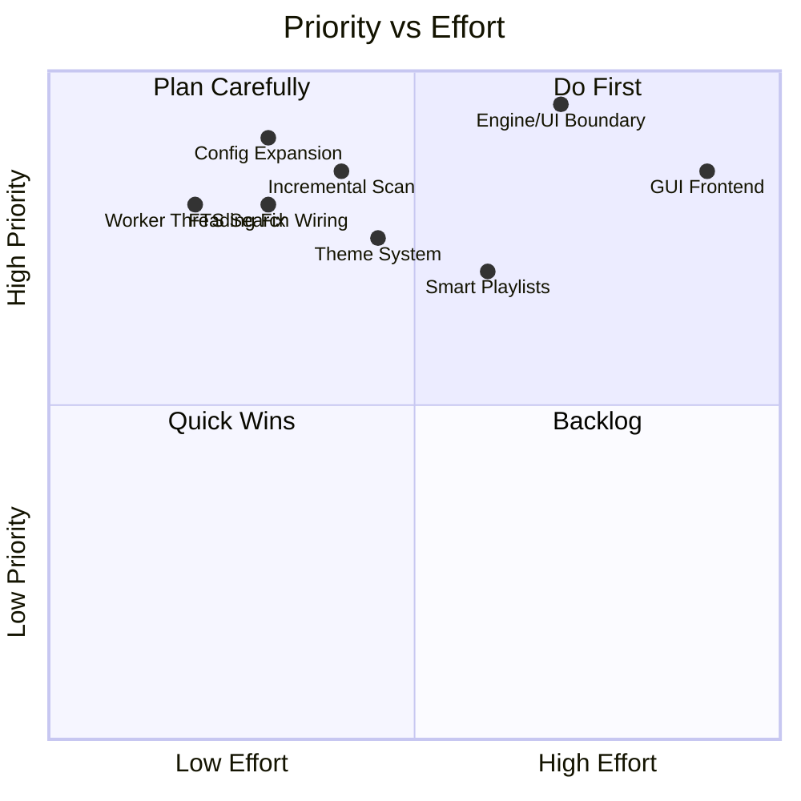

# Melotui — Future Roadmap & Vision

> **North Star**: Melotui becomes a frontend-agnostic local music engine, with the TUI as the power-user interface and a GUI as the approachable visual interface. It should feel like a futuristic local-first music cockpit.

## Priority Matrix

---

## Phase 1: Stabilize And Polish (Immediate)

The immediate next work focuses on fixing up the current foundation. Since basic tests and config exist, we expand on them.

- **Documentation**: Keep `future-roadmap.md` matching reality.
- **Configuration**: Expand beyond UI width/scrolloff: music directory, audio defaults, visualizer defaults, download path, keybindings, theme.
- **Worker Efficiency**: Replace DB worker polling with blocking or timeout receive. Audio can keep ticking, DB/download should sleep less wastefully.
- **Scan Improvements**:
  - Add scan progress events: scanned files, skipped files, failed files, elapsed time.
  - Implement true incremental scanning using file size + modified timestamp before parsing tags.
- **Search Integration**: Route `DatabaseCommand::SearchTracks` into the live app, using the existing FTS5 schema.
- **UX Polish**: Improve error UX: worker errors should become visible, actionable notifications.
- **Testing**: Add tests around playback queue behavior, playlist optimism/rollback, scan/load flows, and command parsing.

---

## Phase 2: Make The TUI Feel Premium

The TUI should remain keyboard-native, dense, fast, and a little magical.

- **Command Palette**: fuzzy commands, recent commands, contextual actions.
- **Search Overlay**: live results across songs, artists, albums, playlists.
- **Theme System**: named themes, truecolor/fallback palettes, per-widget semantic colors.
- **Queue Editor**: reorder queue, move to top, save queue as playlist.
- **Playlist Editing**: rename, reorder tracks, duplicate, export/import.
- **Metadata Screen**: bitrate, format, sample rate, file path, lyrics, album art, play count.
- **Mouse Support**: select rows, seek progress bar, adjust sliders.
- **Modes**: Evolve focus layouts into modes: library mode, visualizer mode, DJ/mixer mode, now-playing mode.

---

## Phase 3: Library Intelligence

Stop being only a file browser and become a smart library manager. Requires DB schema v2 (`plays`, `ratings`, `tags`, `track_tags`, `lyrics`, `smart_playlists`, `audio_features`).

- **History**: Listening history table. Recently played, most played, never played.
- **Smart Playlists**: “favorites from 2020s”, “unplayed FLAC”, “late-night low BPM”.
- **Metadata**: Ratings, tags, moods, custom labels. Duplicate detection by metadata and duration. Missing metadata detection.
- **Art & Lyrics**: Cover art refresh and manual override. Lyrics support from embedded tags, `.lrc`, and optional online providers.
- **Playback**: ReplayGain / loudness normalization. Gapless playback and crossfade.

---

## Phase 4: Audio Engine Overhaul

Turn Melotui into a small local DJ workstation.

- **Equalizer**: Preset-based EQ and effects. Per-track remembered volume/effects. 10-band or parametric equalizer.
- **Transitions**: Crossfade, gapless, fade in/out.
- **Routing**: Output device selection.
- **Analysis**: Audio feature extraction (BPM, loudness, spectral centroid, energy). ReplayGain computation.
- **Plugins**: Visualizer plugin API (terminal visualizers now, GUI visualizers later).

---

## Phase 5: GUI Frontend

**Strategic Move**: Do not build the GUI as a separate app. First split Melotui into components:

- `melotui-engine`: playback, DB, scanning, queue, commands, events
- `melotui-tui`: Ratatui frontend
- `melotui-gui`: desktop frontend (Tauri + Rust backend or Iced)
- *optional* `melotui-daemon`: long-running background engine
- *optional* `melotui-api`: local HTTP/WebSocket or IPC API

**GUI First Version**:

- library grid/list
- now-playing screen
- queue sidebar
- album/artist pages
- search
- playlist editor
- visualizer canvas
- settings
- download manager

The GUI should not replace the TUI. It makes Melotui feel like one engine with two personalities.

---

## Phase 6: Futuristic Layer

Once the foundation is strong, add AI and network capabilities:

- **AI Discovery**: AI playlist builder (“make me a rainy night playlist from my library”). Semantic search (“songs like this but calmer”). Auto-tagging by mood/energy. Local embeddings for library discovery. Voice commands.
- **Ecosystem**: Phone remote control over local network. Discord Rich Presence / MPRIS / media keys. Plugin system for visualizers, metadata providers, lyrics providers, themes. Sync profile across machines without owning the music files.

---

## Recommended Next 5 Moves

1. Update `docs/future-roadmap.md` to reflect the current codebase. (Done)
2. Finish the library/search foundation: incremental scan + FTS search + scan progress.
3. Expand config and theme support.
4. Add listening history and smart playlists.
5. Extract a frontend-neutral engine boundary before starting GUI work.
