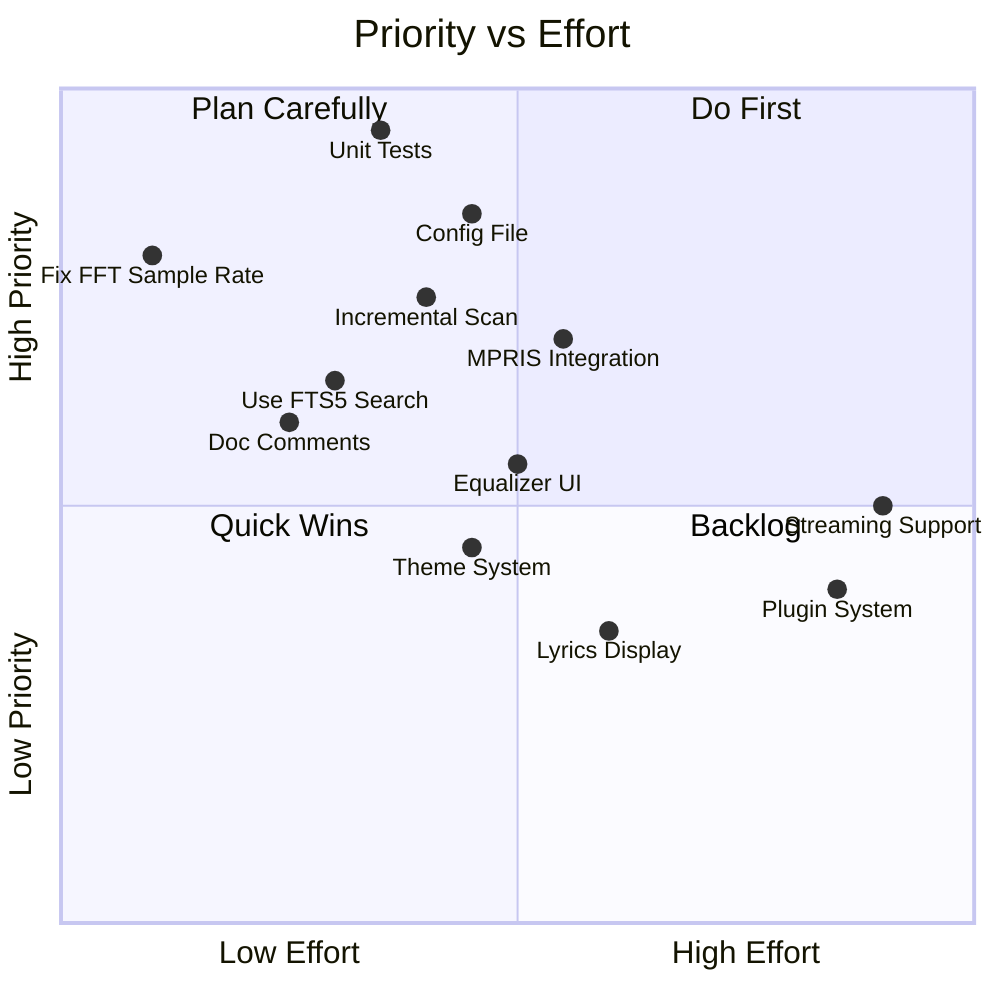
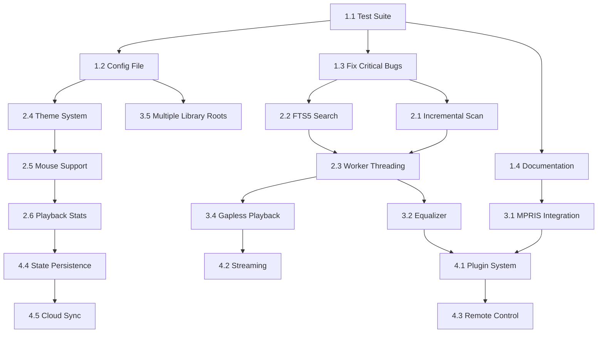

# melotui — Future Roadmap & Next Steps

> **Based on**: Full codebase analysis of ~10,684 lines across 8 crates
> **Philosophy**: Stabilize → Polish → Expand

---

## Priority Matrix



---

## Phase 1: Stabilization (Immediate — Weeks 1-4)

### 1.1 🧪 Add Test Suite

> [!IMPORTANT]
> This is the **highest priority** item. The reducer pattern makes this project *ideal* for testing, yet zero tests exist.

**What to test first** (ordered by impact):

| Test Target | Type | Why |
|---|---|---|
| `reducer::reduce()` | Unit | Core state machine — test every message variant |
| `Command::from_str()` | Unit | User-facing parser — edge cases matter |
| `LibrarySnapshot::new()` | Unit | Index building (artists, albums, genres, years) |
| `projector::get_visible_rows()` | Unit | Virtual scrolling correctness |
| `InputProcessor::coalesce()` | Unit | Event deduplication logic |
| `create_audio_graph()` | Integration | DSP graph instantiation |
| DB `insert_or_replace_track()` | Integration | Upsert behavior with SQLite |
| Full playback cycle | E2E | Play → progress → seek → finish → next |

**Implementation approach**:

```
crates/melotui-core/src/action/playback_action.rs  → add #[cfg(test)] mod tests
crates/melotui-core/src/command.rs                 → add #[cfg(test)] mod tests
crates/melotui-core/src/library/projector.rs       → add #[cfg(test)] mod tests
crates/melotui-db/tests/                           → integration tests with temp DB
```

**Effort**: ~3-5 days for initial coverage of core reducers and command parsing

---

### 1.2 📝 Configuration File

Add a TOML config file at `~/.config/melotui/config.toml`:

```toml
[general]
music_directory = "~/Music"
seek_offset_seconds = 5
scrolloff = 3

[audio]
default_volume = 0.8
default_speed = 1.0

[visualizer]
default_style = "cava"  # cava, default, bar, particle
fps = 60

[keybindings]
quit = "q"
play_pause = "space"
# ... allow full customization

[ui]
show_album_art = true
sidebar_width_percent = 22

[download]
format = "mp3"
quality = "0"  # yt-dlp audio quality (0 = best)
```

**Implementation plan**:

1. Add `serde` + `toml` dependencies to `melotui-core`
2. Create `config.rs` module with `Config` struct implementing `Default`
3. Load config in `melotui-bin/src/runtime.rs` at startup
4. Pass config to `AppState::new()` and relevant workers
5. Make `KeyRegistry::default()` configurable via the config

**Effort**: ~2-3 days

---

### 1.3 🐛 Fix Critical Bugs

#### Fix hardcoded FFT sample rate

In [fft.rs](file:///home/m-d-nabeel/Project/melotui/crates/melotui-audio/src/fft.rs#L49), pass the actual sample rate from the decoder:

```diff
- samples_fft_to_spectrum(&hann_window, 44100, ...)
+ samples_fft_to_spectrum(&hann_window, self.sample_rate, ...)
```

Store `sample_rate` in `SpectrumAnalyzer` and set it when the audio source changes.

#### Replace unwrap() calls

In [worker.rs](file:///home/m-d-nabeel/Project/melotui/crates/melotui-download/src/worker.rs#L142-L143):

```diff
- let stderr = child.stderr.take().unwrap();
- let stdout = child.stdout.take().unwrap();
+ let stderr = match child.stderr.take() {
+     Some(s) => s,
+     None => { let _ = tx.send(InternalEvent::Failed("No stderr".into())); return; }
+ };
```

#### Fix float comparison in FFT

```diff
- freqs.binary_search_by(|f| f.partial_cmp(&start_f).unwrap())
+ freqs.binary_search_by(|f| f.total_cmp(&start_f))
```

**Effort**: ~1 day

---

### 1.4 📖 Add Documentation

1. Add `///` doc comments to all public types and functions, prioritizing:
   - [AppState](file:///home/m-d-nabeel/Project/melotui/crates/melotui-core/src/app_state.rs#L19-L40) — document every field
   - [AppMsg](file:///home/m-d-nabeel/Project/melotui/crates/melotui-core/src/message/mod.rs#L16-L32) — document each variant's lifecycle
   - [IpcWorker](file:///home/m-d-nabeel/Project/melotui/crates/melotui-ipc/src/channel/mod.rs#L13-L17) — document the threading model
2. Create `ARCHITECTURE.md` with the Mermaid diagram from the analysis
3. Create `CONTRIBUTING.md` with build instructions and coding standards
4. Create `CHANGELOG.md` tracking changes by version

**Effort**: ~2-3 days

---

## Phase 2: Polish & Performance (Weeks 5-10)

### 2.1 ⚡ Incremental Library Scan

The current scanner re-reads every file's metadata on each scan. Implement skip-if-unchanged:

```rust
fn should_rescan(conn: &Connection, path: &str, current_mtime: i64) -> bool {
    match conn.query_row(
        "SELECT file_modified_at FROM tracks WHERE file_path = ?",
        params![path],
        |row| row.get::<_, i64>(0),
    ) {
        Ok(stored_mtime) => stored_mtime != current_mtime,
        Err(_) => true, // new file
    }
}
```

**Expected improvement**: 10-100x faster rescans for unchanged libraries.

**Effort**: ~1-2 days

---

### 2.2 🔍 Use FTS5 for Search

The database has a full FTS5 index (`tracks_fts`) but search currently uses in-memory `HashMap` iteration. Wire up the database search:

1. Add a `DatabaseCommand::FTSSearch { query }` command
2. In the DB worker: `SELECT * FROM tracks_fts WHERE tracks_fts MATCH ?`
3. Return results as `IpcEvent::SearchResults { matches }`
4. Update `LibraryMsg::Search` to dispatch to DB instead of in-memory scan

**Benefits**: Much faster search for large libraries, substring matching, ranking by relevance.

**Effort**: ~2 days

---

### 2.3 🔌 Worker Threading Improvements

Replace busy-poll loops with proper blocking receives:

**For DB and download workers**:

```rust
// Instead of:
loop {
    if let Some(cmd) = worker.try_recv() { ... }
    thread::sleep(Duration::from_millis(10));
}

// Use:
loop {
    match worker.recv() {  // blocks until command arrives
        Some(cmd) => handle(cmd),
        None => break,     // channel closed
    }
}
```

The download worker needs a hybrid approach since it also monitors child processes — use `recv_timeout()`.

**Effort**: ~1 day

---

### 2.4 🎨 Theme System

Create a theming system that maps semantic colors to terminal colors:

```toml
[theme]
name = "Tokyo Night"
bg = "#1a1b26"
fg = "#c0caf5"
accent = "#7aa2f7"
highlight = "#bb9af7"
warning = "#e0af68"
error = "#f7768e"
playing = "#9ece6a"
```

Apply these via `Style::default().fg(theme.accent)` throughout the widget layer.

**Effort**: ~3-4 days

---

### 2.5 🖱️ Mouse Support

Ratatui supports mouse events. Add:

- Click to select items in sidebar/queue
- Click on progress bar to seek
- Scroll wheel for volume control
- Click on visualizer to toggle styles

**Effort**: ~2-3 days

---

### 2.6 📊 Playback Statistics

The DB schema already has `play_count` — wire it up:

1. Send `DatabaseCommand::IncrementPlayCount` when `AudioFinished` fires
2. Add a "Most Played" category in the sidebar
3. Add "Recently Played" using `updated_at` timestamps

**Effort**: ~2 days

---

## Phase 3: Feature Expansion (Months 2-4)

### 3.1 🎛️ MPRIS D-Bus Integration (Linux)

Integrate with Linux desktop media controls:

```
New crate: melotui-mpris
```

- Expose playback state, track metadata, and album art to MPRIS2
- Support external play/pause/next/prev from DE media keys
- Show track in notification centers (KDE, GNOME)

**Effort**: ~4-5 days

---

### 3.2 🎚️ Graphical Equalizer

Extend the DSP graph with a multi-band parametric EQ:

- 10-band EQ with configurable center frequencies
- Presets: Flat, Rock, Pop, Jazz, Classical, Custom
- Visual EQ curve display in the TUI

```rust
// New DSP node in effects.rs
fn build_eq_chain(bands: &[EqBand]) -> Box<dyn AudioUnit> {
    let mut chain = pass();
    for band in bands {
        chain = chain >> (pass() | constant(band.freq) | constant(band.q) | constant(band.gain))
            >> bell();
    }
    Box::new(chain)
}
```

**Effort**: ~3-4 days

---

### 3.3 📜 Lyrics Display

- Extract embedded lyrics from audio files (Lofty supports this)
- Display synchronized lyrics (`.lrc` format) in the visualizer pane
- Fetch lyrics from online sources (optional, with user consent)

**Effort**: ~3-5 days

---

### 3.4 🎵 Gapless Playback

Current implementation stops and recreates the sink between tracks. Implement gapless:

1. Pre-buffer the next track's decoder before current track finishes
2. Use `Sink::append()` to queue the next track seamlessly
3. Handle crossfade option (blend last N ms of current with first N ms of next)

**Effort**: ~4-5 days

---

### 3.5 📂 Multiple Library Roots

Allow users to configure multiple music directories:

```toml
[library]
paths = ["~/Music", "/mnt/nas/music", "~/Downloads/music"]
```

Update `LibrarySnapshot` to handle multiple roots and the folder tree to show them as top-level nodes.

**Effort**: ~2-3 days

---

### 3.6 🔊 Audio Output Selection

Allow choosing between available audio devices:

- List available outputs using Rodio's device enumeration
- Add `:output <device>` command
- Persist selection in config

**Effort**: ~2-3 days

---

## Phase 4: Long-Term Vision (Months 4+)

### 4.1 🧩 Plugin System

Design an extensible architecture for user-defined plugins:

```
melotui-plugin (new crate)
├── Plugin trait
├── PluginManager
├── Example plugins:
│   ├── scrobbler (Last.fm/ListenBrainz)
│   ├── discord-rpc (Discord Rich Presence)
│   ├── remote-control (HTTP API)
│   └── auto-tagger (MusicBrainz lookup)
```

Interface:

```rust
pub trait Plugin: Send {
    fn name(&self) -> &str;
    fn on_track_change(&mut self, track: &TrackMeta) {}
    fn on_playback_state(&mut self, state: &PlaybackStatus) {}
    fn on_progress(&mut self, position_ms: u64) {}
}
```

**Effort**: ~2 weeks for the plugin framework

---

### 4.2 🌐 Streaming Support

Add streaming audio source support:

- Internet radio streams (Icecast/Shoutcast)
- Podcast RSS feeds
- Network-mounted libraries (SMB/NFS paths)

**Effort**: ~2-3 weeks

---

### 4.3 📱 Remote Control Server

Add an HTTP/WebSocket server for remote control:

```
melotui-remote (new crate)
├── REST API: /api/playback, /api/library, /api/queue
├── WebSocket: real-time state push
├── Web UI: minimal HTML control page
```

**Effort**: ~2 weeks

---

### 4.4 🔄 State Persistence

Save and restore session state across restarts:

- Current track position, queue, expanded nodes, visualizer settings
- Use `serde` serialization to JSON/TOML
- Auto-save on quit, auto-restore on start

**Effort**: ~2-3 days

---

### 4.5 ☁️ Cloud Sync

Sync playlists, favorites, and play counts across devices:

- Export/import as JSON
- Optional integration with music services (ListenBrainz)

**Effort**: ~1-2 weeks

---

## Implementation Order — Dependency Graph



---

## Quick Wins (< 1 day each)

These can be done anytime without blocking other work:

| Task | Effort | Impact |
|---|---|---|
| Fix hardcoded FFT sample rate | 30 min | Correct spectrum on non-44.1kHz files |
| Replace `unwrap()` calls with proper error handling | 1 hour | Prevents panics |
| Use `_` wildcard in match arms instead of listing all variants | 30 min | Cleaner code |
| Add `.desktop` file for Linux | 30 min | Better desktop integration |
| Rename `melotui-ipc` to `melotui-worker` | 1 hour | More accurate naming |
| Add `IncrementPlayCount` on track finish | 30 min | Enable play stats |
| Add `--version` CLI flag | 15 min | Standard CLI behavior |
| Add `Cargo.toml` workspace metadata (description, license, keywords) | 30 min | Better crate metadata |

---

## Packaging & Distribution

### Current state

- GitHub Releases with pre-built binaries ✅
- Cross-platform CI ✅

### Next steps

| Package | Platform | Effort |
|---|---|---|
| AUR package | Arch Linux | 1 day |
| Homebrew formula | macOS | 1 day |
| `.deb` package | Debian/Ubuntu | 1 day |
| Flatpak | Linux (universal) | 2 days |
| Snap | Ubuntu | 1 day |
| Nix flake | NixOS | 1 day |
| Cargo publish | crates.io (binary) | 30 min |

---

## Metrics to Track

Set up dashboards for:

- **Code coverage**: Target 60% in Phase 1, 80% by Phase 3
- **Binary size**: Currently optimized with LTO — track regressions
- **Startup time**: Measure time from launch to first render
- **Memory usage**: Track with large libraries (10k+ tracks)
- **Clippy warnings**: Keep at zero (already enforced in CI)

---

## Community Building

1. **Polish README** with GIF/video demo of the TUI in action
2. **Add screenshots** showing different visualizer styles and album art
3. **Post to** r/rust, r/commandline, Hacker News
4. **Create GitHub Discussions** for feature requests
5. **Add issue templates** for bugs and feature requests
6. **Set up GitHub Projects** board for roadmap tracking
